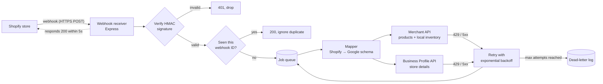

# Shopify → Google Merchant API Product Sync

A reference implementation and integration recipe for merchants and platforms connecting a Shopify store to Google's commerce surfaces.

The service listens for Shopify product and inventory webhooks. It keeps Google Merchant Center in sync through the **Merchant API**, and keeps store details current through the **Google Business Profile API**. It is written in TypeScript (Node.js) and is meant to be read, forked and adapted, not just run.

> **Status:** 🚧 In active development. See the [Roadmap](#roadmap) for what is built and what is still to come.

---

## Why this exists

I support Shopify merchants whose product feeds and inventory fall out of sync with external sales channels. The most common causes I see are:

- **Silent drift.** A product changes in Shopify, but the channel never hears about it.
- **Unhandled edge cases.** Variants, missing GTINs, out-of-stock items and deleted products are not handled.
- **Weak error handling.** One failed API call is lost forever because nothing retries.

This project shows how to build that integration properly, end to end, with the failure cases handled explicitly.

---

## What it does

| Shopify event | What happens on the Google side |
|---|---|
| `products/create` | Each variant is mapped to a Merchant API `ProductInput` and inserted |
| `products/update` | The affected variants are re-inserted, which works as an upsert |
| `products/delete` | Each variant's `ProductInput` is deleted |
| `inventory_levels/update` | The local inventory (store-level availability and quantity) is updated for that location |
| `locations/update` | The matching Business Profile location (address, hours, phone) is patched |

---

## Architecture



### Design decisions

- **Respond fast, process later.** Shopify expects a `200` within 5 seconds and retries if it doesn't get one. The receiver only verifies, de-duplicates and enqueues; all Google API calls happen in a worker.
- **Idempotent by design.** Shopify can deliver the same webhook more than once. Every event is keyed on `X-Shopify-Webhook-Id`, and Merchant API inserts are upserts, so replaying an event is safe.
- **One Shopify variant = one Google product.** Variants share an `itemGroupId` (the Shopify product ID), so Google groups them as one product with options.
- **The mapping lives in one place.** Every field translation is in `src/mappers/`, with unit tests. This is where most real-world integration bugs live.

---

## Field mapping

| Google field | Shopify source | Notes |
|---|---|---|
| `offerId` | `variant.sku`, falling back to `variant.id` | Must be stable. Changing it creates a new product in Merchant Center |
| `title` | `product.title` + variant options | For example, "Linen Shirt – Blue / M" |
| `description` | `product.body_html` | HTML stripped |
| `link` | Store URL + `/products/{handle}?variant={id}` | |
| `imageLink` | Variant image, falling back to the first product image | |
| `price` | `variant.price` + shop currency | Sent as `amountMicros` |
| `salePrice` | `variant.price` when `compare_at_price` is higher | |
| `availability` | `inventory_quantity` and `inventory_policy` | `in_stock`, `out_of_stock` or `backorder` |
| `gtin` / `mpn` | `variant.barcode` / `variant.sku` | Missing identifiers are logged as warnings |
| `brand` | `product.vendor` | |
| `itemGroupId` | `product.id` | Groups the variants together |

---

## Error handling

| Situation | Behaviour |
|---|---|
| Invalid HMAC signature | Reject with `401`; nothing is processed |
| Duplicate webhook | Acknowledge with `200` and skip |
| `429` rate limit or `5xx` from Google | Retry with exponential backoff and jitter (1s, 2s, 4s… up to 5 attempts) |
| `400` validation error (bad data) | No retry. Logged with the product ID and Google's error message so the data can be fixed |
| `401` / `403` from Google | Stop the worker and raise an alert, because credentials or permissions are broken |
| Retries exhausted | Written to the dead-letter log for manual replay |

Every log line carries the Shopify webhook ID and the `offerId`, so one product can be traced end to end.

---

## Getting started

### Prerequisites

- Node.js 20+
- A Shopify development store and a custom app with the `read_products`, `read_inventory` and `read_locations` scopes
- A Google Merchant Center account and a Google Cloud project with the **Merchant API** enabled
- A service account with access to your Merchant Center account
- *(Optional)* Business Profile API access. Google approves this separately, so request it early

### Setup

```bash
git clone https://github.com/TheShola/shopify-merchant-api-sync.git
cd shopify-merchant-api-sync
npm install
cp .env.example .env   # then fill in the values below
npm run dev
```

### Environment variables

| Variable | Description |
|---|---|
| `SHOPIFY_WEBHOOK_SECRET` | Your app's client secret, used to verify webhook signatures |
| `SHOPIFY_STORE_DOMAIN` | For example, `your-store.myshopify.com` |
| `GOOGLE_MERCHANT_ACCOUNT_ID` | Your Merchant Center account ID |
| `GOOGLE_DATA_SOURCE` | The API data source that products are written to |
| `GOOGLE_APPLICATION_CREDENTIALS` | Path to the service account key file |
| `GBP_LOCATION_MAP` | *(Optional)* JSON map of Shopify location ID → Business Profile location ID |
| `PORT` | Defaults to `3000` |

> Never commit `.env` or key files. Both are in `.gitignore`.

### Try it locally

```bash
# Expose the local server to Shopify
npx ngrok http 3000

# Send a signed sample webhook without a real store
npm run simulate -- products/update samples/product-update.json
```

### Tests

```bash
npm test
```

The tests cover the field mapper, signature verification, de-duplication and retry behaviour.

---

## Project structure

```
src/
  server.ts            Express app and webhook routes
  verify.ts            Shopify HMAC verification
  queue.ts             In-memory job queue (swap for Pub/Sub or SQS in production)
  mappers/
    product.ts         Shopify variant → Merchant API ProductInput
    localInventory.ts  Inventory level → local inventory
    location.ts        Shopify location → Business Profile location
  clients/
    merchantApi.ts     Merchant API client with retry
    businessProfile.ts Business Profile API client
  retry.ts             Exponential backoff with jitter
samples/               Sample webhook payloads for testing
tests/
```

---

## Extending to the Universal Commerce Protocol (UCP)

UCP extends Google commerce beyond product listings toward agent-led shopping and checkout. Building this sync surfaced several questions that matter when you move from *listing* products to *transacting* on them:

- **Freshness becomes critical.** A stale price or stock level is a minor problem in a listing. In a checkout, it's a failed order. The event-driven design here (no batch feeds) is the right foundation.
- **Stable identifiers carry more weight.** Order and cart flows need `offerId` to map back to a Shopify variant with no ambiguity, which is why it is never derived from mutable fields.
- **Edge cases worth testing against the spec:** variants that sell out mid-checkout, products deleted while in a cart, multi-currency pricing, and stores that allow backorders.

These notes will grow as I test against the protocol.

---

## Roadmap

- [x] Project scope, architecture and field mapping
- [x] Webhook receiver with HMAC verification and de-duplication
- [ ] Product insert, update and delete via the Merchant API
- [ ] Local inventory updates
- [x] Retry, backoff and dead-letter handling
- [ ] Business Profile location sync
- [ ] Webhook simulator and sample payloads
- [ ] Unit tests and CI
- [ ] Deployment guide (Railway / Cloud Run)

---

## Author

**Shola Abimbola** · [LinkedIn](https://linkedin.com/in/shola-abimbola) · [GitHub](https://github.com/TheShola)

Built from the experience of troubleshooting merchant integrations and product feeds at Shopify.

## License

MIT
